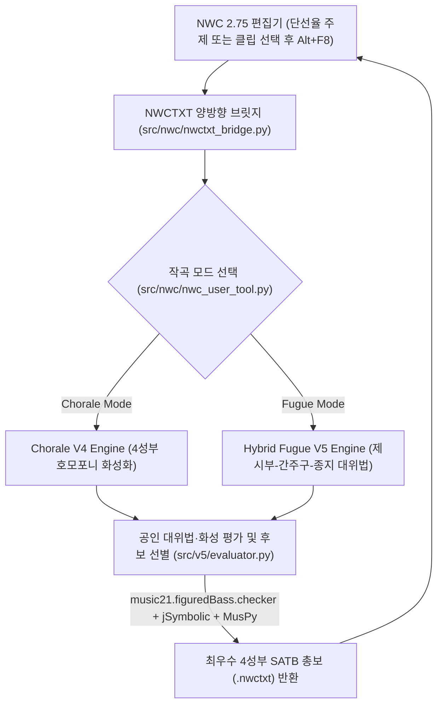

# Like Bach: Baroque Counterpoint & NWC 2.75 Generative Engine v5.1

     

바흐(J.S. Bach)의 4성부 코랄 화성학 및 평균율 클라비어곡집(WTC Books I & II, BWV 846-893) 다성 푸가 대위법을 학습하여, NoteWorthy Composer 2 (NWC 2.75) 내부에서 단축키(`Alt+F8`)만으로 단선율 주제를 4성부 코랄 및 푸가 총보로 확장하는 작곡 부가기능(User Tool) 및 추론 엔진입니다.

---

## 주요 기능 (v5.1 Update)

- [NWC 2.75 네이티브 부가기능 연동]: `src/nwc/nwctxt_bridge.py` 및 `src/nwc/nwc_user_tool.py`를 통해 NWC 2.75의 표준 입출력(`NWCTXT` FileText 및 ClipText)과 직접 통신하며, 높은음자리표·낮은음자리표·가온음자리표·테너음자리표 오선 좌표(`Pos`) 변환, 마디 경계 붙임줄(`^`) 분할, 8분/16분음표 꼬리 묶기(`Beam`)를 자동으로 처리합니다.
- [듀얼 신경망 아키텍처 (Chorale V4 & Fugue V5)]:
  - 코랄 엔진 (`v4`): 수직적 화성 진행 및 로마자 화성 컨텍스트(`[ROMAN_I]`, `[ROMAN_V7]`)에 기반한 4성부 화성화
  - 푸가 엔진 (`v5`): 회전 위치 임베딩(`RoPE`) 및 4D 배치 `cuDNN SDPA` 기반 트랜스포머로 주제-응답(`Subject-Answer`) 제시부, 대주제(`Countersubject`), 간주구(`Episode`), 종지(`[FINAL]`) 전개
- [Hugging Face Hub 가중치 관리 및 자동 복구]: 모든 모델 가중치(`.pt`, `.safetensors`, `.onnx`)와 단어장(`.pkl`)은 [chemahc94/like-bach-models](https://huggingface.co/chemahc94/like-bach-models)에 호스팅되며, 로컬 파일 부재 시 엔진 초기화 단계에서 자동으로 다운로드 및 SHA-256 무결성 검증을 수행합니다.
- [공인 심볼릭 음악 평가 파이프라인 (`src/v5/evaluator.py`)]: 임의의 휴리스틱 점수를 배제하고 MIT `music21.figuredBass.checker`(병행/은복 5·8도, 성부 교차·침범), McGill 대학 `jSymbolic 2.2`(순차 진행 비율, 증4도 도약 등 72종), UCSD `MusPy`(`scale_consistency`, `polyphony_rate`, `pitch_class_entropy`, `groove_consistency`), Georgia Tech `MGEval`(`Overlapping Area` 및 `KLD`) 공식 지표를 통해 생성 후보 악보를 선별·검증합니다.
- [원곡 단위 데이터 분할 (Data Leakage 차단)]: 12키 전조 및 성부 교환 증강 이전에 원곡(BWV) 단위로 `Train (80%) / Val (10%) / Test (10%)`를 분리(`data/processed/v5/split_manifest.json`)하여 검증 데이터 누수를 원천 차단합니다.

---

## 시스템 아키텍처



---

## 설치 및 실행 방법

### 1. 환경 구성 및 패키지 설치

Python 3.10 이상(CUDA 지원 GPU 권장) 환경에서 의존성을 설치합니다.

```bash
pip install -r requirements.txt
```

### 2. 모델 가중치 및 단어장 다운로드 (선택)

추론 시 자동으로 Hugging Face Hub에서 내려받지만, 오프라인 환경을 위해 사전에 일괄 다운로드하고 SHA-256 해시를 검증하려면 다음 명령을 실행합니다.

```bash
python download_models.py
```

### 3. NoteWorthy Composer 2 (NWC 2.75) User Tool 자동 등록

아래 설치 스크립트를 실행하면 Windows의 NWC 2.75 설정(`nwc2UserTools.ini` 및 레지스트리)에 4종의 `Like_Bach` User Tool이 즉시 등록됩니다.

```bash
python scripts/install_nwc_tool.py
```

등록되는 도구 목록:
- `Like_Bach: 4-Voice Chorale (Full Score)`
- `Like_Bach: 4-Voice Fugue (Full Score)`
- `Like_Bach: Custom Generator (Prompt)`
- `Like_Bach: Harmonize Selected Clip`

### 4. 공인 작곡 품질 평가 및 테스트 실행

```bash
# 바흐 원곡 코퍼스 및 생성 모델 공인 지표 벤치마크 실행
python -m src.v5.evaluator

# 단위 및 통합 테스트 실행
pytest tests/ -v
ruff check src/v5/ src/nwc/ tests/
```

### 5. 원곡 단위 데이터 전처리 및 모델 재학습

```bash
# 푸가(V5) 원곡 단위 분할 전처리 및 학습
python src/v5/preprocess_fugue.py
python src/v5/train_fugue.py

# 코랄(V4) 전처리 및 학습
python src/v4/preprocess.py
python src/v4/train.py
```

---

## 데이터 출처 및 라이선스 (Dataset Attribution & License)

- 본 프로젝트의 코드는 [MIT License](file:///C:/Users/sg/Documents/Github/Like_Bach/LICENSE) 하에 배포됩니다.
- 평균율 클라비어곡집(WTC Books I & II, BWV 846-893) 및 2성 인벤션(BWV 772-786) 심볼릭 악보 데이터는 스탠퍼드 대학교 CCARH의 [KernScores](https://kern.humdrum.org) (`humdrum-tools/bach-wtc`, Craig Stuart Sapp)를 출처로 합니다.
- 4성부 코랄 데이터 및 성부 진행 공식 검증 모듈은 MIT의 [music21](https://www.music21.org) (Michael Scott Cuthbert & Christopher Ariza) 코퍼스를 활용합니다.
