# Like Bach: Harmonic Generative Engine v4.6

    

바흐의 4성부 화성 체계를 학습하고, DeepBach 및 BachBot의 선진 알고리즘을 이식하여 음악적 논리성과 구조적 완결성을 극대화한 통합 작곡 엔진입니다. 데이터 전처리 파이프라인의 글로벌 오프셋 추출 로직과 프론트엔드 실시간 렌더링·재생 동기화, 그리고 NoteWorthy Composer 2 (NWC 2.75) 부가기능(User Tool) 연동을 지원합니다.

## Key Features (v4.6 Update)

- [4-Voice Integrated Harmony]: 소프라노 주제 입력 시 알토, 테너, 베이스를 유기적으로 동시 생성합니다.
- [Functional Harmony Awareness]: 로마자 화성 기호(`[ROMAN_I]`, `[ROMAN_V7]` 등)를 명시적으로 학습하여 화성적 개연성과 음악적 정통성을 확보했습니다.
- [Structural Measure Control]: 마디 카운트다운(`[REMAIN_N]`) 및 종지(`[FINAL]`) 토큰을 통해 사용자가 원하는 길이를 제어하고 자연스러운 마무리가 가능합니다.
- [Global Offset Training]: 곡의 수평적, 수직적 화성을 온전히 학습하기 위해 절대 오프셋 기반의 훈련 데이터 추출 로직을 새롭게 적용했습니다.
- [Interactive Playback UI]: Tone.js와 VexFlow를 연동하여, 재생 시 실시간으로 현재 연주되는 음표가 하이라이팅되며 악보 전체가 부드럽게 횡스크롤됩니다.
- [Accurate Stem Rendering]: 4성부의 기둥 방향(소프라노/테너 위, 알토/베이스 아래)을 분리 렌더링하여 악보 가독성을 극대화했습니다.
- [NWC 2.75 User Tool Integration]: NoteWorthy Composer 2 내부에서 단축키(`Alt+F8`)만으로 단선율 악보를 4성부 코랄 및 푸가 총보로 즉시 확장합니다.

## 시스템 아키텍처

```mermaid
graph TD
    %% 스타일 정의
    classDef data fill:#2b2b2b,stroke:#4f4f4f,stroke-width:2px;
    classDef engine fill:#1a365d,stroke:#2b6cb0,stroke-width:2px,color:#fff;
    classDef control fill:#744210,stroke:#d69e2e,stroke-width:2px,color:#fff;
    classDef ui fill:#234e52,stroke:#319795,stroke-width:2px,color:#fff;

    %% 1. 데이터 엔지니어링 파트
    A[Raw MIDI / MusicXML Data] --> B(music21 Parser)
    B --> C[Global Offset Interleaved Tokens]
    B --> D[Automated Roman Numeral Context]

    %% 2. 추론 및 실시간 제어 파트 (Dual Engine & Logits Warping)
    C & D --> E{Dual Neural Engine Selection}
    
    subgraph Inference_Loop [Inference Runtime]
        E -->|Homophony| F[Chorale Engine 25M]
        E -->|Polyphony| G[Fugue Engine V5]
        
        F & G --> H[Next Token Logits]
        H --> I[Logits Warping Engine _filter_logits]
        I -->|Anti-Parallelism Masking| J[Strict Harmonic Constraint Evaluation]
        J -->|Feedback & Token Sampling| H
    end

    %% 3. 비동기 브로커 및 프론트엔드/NWC2 동기화
    J -->|Sampled Stream| K[FastAPI Async Broker / NWC2 Bridge]
    
    subgraph Frontend_Studio [React Studio & NWC 2.75 User Tool]
        K -->|Async Streaming| L[State Manager]
        L -->|Microtask Queue Sync| M[VexFlow Score Renderer]
        L -->|Microtask Queue Sync| N[Tone.js Audio Synthesizer]
        M & N --> O[Dynamic Stem Rendering & Real-time H-Scroll Highlighting]
    end

    %% 클래스 지정
    class A,C,D,H data;
    class F,G engine;
    class I,J control;
    class M,N,O ui;
```



### 1. Data Engineering & Interleaving Pipeline
- [Global Offset Alignment]: 성부 간의 수직적 화성 관계와 수평적 대위적 흐름을 보존하기 위해 절대 시간(Global Offset) 기반의 인터리빙(Interleaving) 토큰 파이프라인을 적용했습니다.
- [Automated Harmonic Analysis]: `music21` 라이브러리를 활용하여 원본 데이터로부터 Key 중심의 전조(Modulation) 분석 및 로마자 화성 기호(`[ROMAN_I]`, `[ROMAN_V7]` 등)를 자동으로 추출하여 컨텍스트 토큰으로 주입합니다.

### 2. Dual Neural Engine Inference
- [Chorale Engine (25M)]: 수직적 호모포니(Homophony)에 최적화되어 있으며, 화성적 개연성과 코드 전개(Roman Numeral Context)를 기반으로 4성부를 동시 생성합니다.
- [Fugue Engine (V5)]: 수평적 폴리포니(Polyphony)에 특화된 모델로, 거시 구조 토큰(`[SUBJECT_START]`, `[ANSWER_START]`, `[EPISODE]`)을 해석하여 모방 대위법을 구사합니다.

### 3. Real-time Constraint Control via Logits Warping
- [In-flight Harmonic Filtering]: 추론(Inference) 단계의 `_filter_logits` 엔진 내에 Logits Warping 메커니즘을 내장했습니다.
- [Anti-Parallelism Masking]: 모델이 다음 토큰을 샘플링하기 직전, 대위법적 금기 사항(병행 5도, 병행 8도 등)을 유발할 수 있는 음정 토큰의 확률(Logits)을 마스킹하여 실시간으로 화성학 규칙을 강제합니다.

### 4. Interactive Studio & NWC2 Integration
- [FastAPI Async Broker]: 백엔드 API는 비동기 스트리밍 인터페이스를 제공하여 대용량 컨텍스트 추론 중에도 프론트엔드와의 연결 리소스를 최적화합니다.
- [Dynamic Render & Playback]: 프론트엔드 스튜디오(React)는 `VexFlow`와 `Tone.js`를 동기화 마이크로태스크 큐로 제어합니다.
- [NWC 2.75 User Tool Bridge]: `src/nwc/nwctxt_bridge.py` 및 `src/nwc/nwc_user_tool.py`를 통해 NWC 2.75의 표준 입출력(`NWCTXT`)과 직접 통신하여 4성부 총보를 생성합니다.

## 설치 및 실행 가이드

1. 환경:
   Python 3.10+ 및 CUDA 지원 GPU(RTX 4080/5080 권장) 필요, Node.js 20+

2. 코랄 학습 전처리 및 학습:
   ```bash
   python src/data_fetcher.py
   python src/v4/preprocess.py
   python src/v4/train.py
   ```

3. 푸가 학습 전처리 및 학습:
   ```bash
   python src/v5/preprocess_fugue.py
   python src/v5/train_fugue.py
   ```

4. 백엔드 서버 실행:
   ```bash
   python src/v5/api.py
   ```

5. 프론트엔드 실행:
   ```bash
   cd ui/v4-app
   npm run dev
   ```

6. NoteWorthy Composer 2 (NWC 2.75) User Tool 등록:
   ```bash
   python scripts/install_nwc_tool.py
   ```

## 지속적 통합 (CI/CD)

이 프로젝트는 코드 품질 관리 및 협업 시의 안정성 확보를 위해 GitHub Actions 기반의 지속적 통합(CI) 파이프라인을 가동하고 있습니다.

1. 자동화 워크플로우 (GitHub Actions):
- 트리거 조건: `main` 브랜치 및 기능 브랜치로의 `push` 및 `pull_request` 발생 시 실행
- 백엔드 검증 (`backend-ci`): Python 환경에서 `ruff` 정적 분석 도구를 이용한 코드 린팅 검사 및 `pytest` 기반 단위 테스트 자동 구동
- 프론트엔드 검증 (`frontend-ci`): Node.js 환경에서 ESLint 정적 분석 검사 및 Vite 프로덕션 빌드 성공 여부를 병렬 수행

## Development History

상세한 기술 개발 과정 및 최적화 이력은 `development_log.txt` 및 `plans_replies_walkthrough/`, `reports/` 디렉토리에서 확인할 수 있습니다.

## Future Work

- [1. 오디오 합성 및 MIDI 렌더링 고도화]
  - Tone.js의 단순 Synth를 넘어, FluidSynth 기반의 사운드폰트(SoundFont)나 Web Audio API를 활용하여 파이프 오르간, 쳄발로 사운드 렌더링 품질을 향상합니다.
- [2. 자동 재작곡 루프 강화 및 대위법 교정]
  - 화성 평가(Harmonic Evaluation) 기반의 조건부 루프와 성부 진행(Voice Leading) 유도 로짓 보정을 고도화하여 바흐 대위법의 구조적 완성도를 높입니다.
