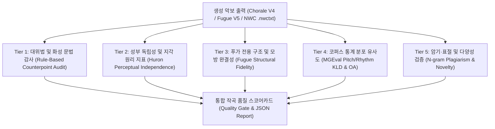

# [ 261109 2340 메인 워크스테이션 ] 바흐 코랄 및 푸가 자동 작곡 품질 정량 평가 방법론 및 벤치마크 설계 보고서

## 1. 개요 및 문제 정의

현재 `Like_Bach` 프로젝트의 코랄(V4) 및 푸가(V5) 생성 파이프라인은 토큰 단위의 교차 엔트로피 손실(`Cross-Entropy Loss`) 및 퍼플렉시티(`Perplexity`)만을 학습 지표로 사용하고 있다. 그러나 심볼릭 음악 생성(Symbolic Music Generation) 및 바로크 다성 대위법(Polyphonic Counterpoint) 영역에서 낮은 토큰 손실값은 음악적·대위법적 완결성을 직접 보장하지 못한다.

특히 이슈 `#27`([학습] v6 학습 파이프라인 재정비: 데이터 분할·모델 크기·평가)에서 지적된 바와 같이 다음 세 가지 구조적 결함을 정량적으로 검증할 수 있는 다차원 평가 체계가 필수적이다.

1. [화성 및 성부 진행 문법 위배]: 토큰 확률 분포상 그럴듯하더라도 실제 악보로 디코딩했을 때 병행 5도·8도(Parallel 5ths/8ths), 성부 교차(Voice Crossing), 미해결 불협화음(Unresolved Dissonance) 등 18세기 대위법의 핵심 금기 규칙을 위배하는 현상.
2. [데이터 누수 및 암기(Overfitting / Plagiarism)]: 12키 전조(Transposition) 증강 이후 무작위 분할을 수행할 경우 동일 원곡의 다른 조성이 학습셋과 검증셋에 동시 분포하여 모델이 대위법 원리를 일반화하는 대신 원곡 음형을 그대로 복제하는 현상.
3. [푸가 형식(Exposition - Episode - Cadence)의 구조적 붕괴]: 4성 푸가에서 주제(Subject)와 응답(Answer, Tonal/Real)의 조성적 모방 관계, 대주제(Countersubject)의 보존, 그리고 종지(`[FINAL]`) 구간의 정격종지(`V-I` / `V7-I`) 해결 실패.

본 보고서는 서구권 주요 컴퓨터 음악학 및 심볼릭 음악 생성 선행 연구들을 바탕으로, `Like_Bach` 코랄 및 푸가 모델의 작곡 품질을 객관적으로 감사(Audit)하고 자동화된 CI/CD 및 V6 학습 게이트에 즉시 통합할 수 있는 5대 정량 평가 프레임워크를 제시한다.

---

## 2. 이론적 배경 및 핵심 선행 연구 (Literature Review)

본 평가 체계는 바로크 다성 음악의 지각적·수학적 원리와 심볼릭 음악 생성 모델의 표준 벤치마크를 정립한 다음 핵심 문헌들에 기반한다.

- [Huron (2001), Music Perception (Ohio State University)]: `Tone and Voice: A Derivation of the Rules of Voice-Leading from Perceptual Principles`. 전통 화성학 및 대위법의 성부 진행 규칙들이 청각 장면 분석(Auditory Scene Analysis)의 6대 지각 원리(음역 분리, 비동기 발음, 반진행·사진행 선호 등)로부터 유도됨을 증명하고, 다성 음악의 성부 독립성(Voice Independence)을 정량화하는 지표를 제시함.
- [Cuthbert & Ariza (2010), ISMIR (MIT)]: `music21: A Toolkit for Computer-Aided Musicology and Symbolic Music Data`. `music21.voiceLeading.VoiceLeadingQuartet` 및 `music21.roman` 모듈을 통해 두 성부 간 한 쌍의 수직 음정 변화에서 병행 5도·8도, 은복 5도·8도, 성부 교차, 성부 침범을 결정론적 알고리즘으로 검출하는 표준 분석 체계를 구축함.
- [Tymoczko (2011), Oxford University Press (Princeton University)]: `A Geometry of Music: Harmony and Counterpoint in the Extended Common Practice`. `N`성부 화음을 오비폴드(Orbifold) 기하 공간의 점으로, 성부 진행을 측지선(Geodesic) 경로로 정식화하여 성부 간 이동 거리(Voice-Leading Work, `L1` / `L2` 노름) 및 기능 화성 진행의 전이 일관성을 수학적으로 측정함.
- [Hadjeres, Pachet & Nielsen (2017), ICML (Sony CSL Paris / INRIA)]: `DeepBach: a Steerable Model for Bach Chorales Generation`. 바흐 코랄 389곡을 대상으로 음고·지속시간·성부 간 수직 음정 분포의 일치도와 인간 전문가 튜링 테스트(1,272명 참가자 대상 블라인드 판별) 및 표절 길이(Plagiarism Length) 검사를 결합한 평가 프로토콜을 수립함.
- [Liang, Gotham, Johnson & Shotton (2017), University of Cambridge / Microsoft Research]: `Automatic Stylistic Composition of Bach Chorales with Deep LSTM (BachBot)`. 바흐 원곡 코퍼스를 곡 단위로 분리한 뒤 교차 엔트로피와 N-gram 음형 통계 및 블라인드 구별 평가를 수행하여 토큰 예측 손실과 실제 양식 충실도 간의 상관관계를 분석함.
- [Huang et al. (2017 / 2019), ICML / ISMIR (Google Brain / Magenta)]: `Counterpoint by Convolution (Coconet)`. 깁스 샘플링 기반 인필링 모델의 품질을 검증하기 위해 토큰 단위 음의 로그 우도(Frame-level NLL) 외에 대위법 규칙 위배 빈도 및 음악가 청취 평가를 병행함.
- [Yang & Lerch (2020), Neural Computing and Applications (Georgia Institute of Technology)]: `On the Evaluation of Generative Models in Music (MGEval)`. 생성된 심볼릭 음악 집합과 실제 코퍼스 집합 간의 음고·음정·리듬 특징 분포에 대해 커널 밀도 추정(KDE)을 수행하고, 집합 내부 분포와 집합 간 분포의 쿨백-라이블러 발산(`KLD`) 및 중첩 면적(`Overlapping Area, OA`)을 비교하는 무참조 통계 평가 프레임워크를 정립함.

---

## 3. `Like_Bach` 작곡 품질 평가를 위한 5대 정량 지표 체계

`Like_Bach`의 생성 결과물(`.nwctxt`, `.mid`, 또는 내부 타임스텝 그리드)을 입력받아 자동 채점할 수 있도록 평가 체계를 5개 계층(Tier 1 ~ Tier 5)으로 구조화한다.

### 3.1 [Tier 1] 규칙 기반 성부 진행 및 화성 문법 감사 (Rule-Based Voice-Leading & Harmonic Audit)

`music21.voiceLeading.VoiceLeadingQuartet` 또는 `Like_Bach` 내부의 16분음표 타임스텝 그리드(`S, A, T, B`) 위에서 두 연속된 화음 발음 시점(Attack Point) $t_k \rightarrow t_{k+1}$의 모든 성부 쌍 $(v_i, v_j)$ ($i < j$)에 대해 측정한다.

1. [병행 5도 및 병행 8도 발생률 (`Parallel 5ths / 8ths per Measure, P5/P8`)]:
   - 정의: 두 성부 $(v_i, v_j)$가 시점 $t_k$에서 완전 5도($\equiv 7 \pmod{12}$) 또는 완전 8도/동도($\equiv 0 \pmod{12}$)를 이루고, 시점 $t_{k+1}$에서 두 성부 모두 음고가 변하면서 다시 완전 5도 또는 완전 8도를 이루는 횟수를 총 마디 수로 나눈 값.
   - 수식:
     $$\text{Rate}_{\text{P5/P8}} = \frac{1}{M} \sum_{k=1}^{K-1} \sum_{i < j} \mathbb{I}\left( \Delta p_i(k) \neq 0 \land \Delta p_j(k) \neq 0 \land I_{i,j}(k) = I_{i,j}(k+1) \in \{0, 7\} \right)$$
   - 바흐 원곡 기준치: 바흐 코랄 원곡 코퍼스에서는 마디당 `0.02`회 미만(페르마타 구절 경계 사이의 비연속 진행을 제외하면 사실상 `0.00`).

2. [외성 간 은복 5도·8도 발생률 (`Hidden / Direct 5ths & 8ths on Outer Voices`)]:
   - 정의: 소프라노($S$)와 베이스($B$)가 같은 방향(유사 진행, Similar Motion)으로 진행하여 완전 5도 또는 완전 8도에 도달할 때, 소프라노가 도약($|\Delta p_S| > 2$ 반음)하는 비율.

3. [성부 교차 및 성부 침범률 (`Voice Crossing & Overlap Ratio`)]:
   - 성부 교차(Voice Crossing): 동일 시점 $t$에서 상위 성부의 MIDI 음고가 하위 성부보다 낮아지는 비율 ($p_S(t) < p_A(t)$ 또는 $p_A(t) < p_T(t)$ 또는 $p_T(t) < p_B(t)$).
   - 성부 침범(Voice Overlap): $p_S(t_{k+1}) < p_A(t_k)$와 같이 인접 시점의 타 성부 음역을 침범하는 비율.

4. [표준 음역 이탈률 (`SATB Range Violation Rate`)]:
   - 발음된 전체 음표 중 표준 성부 음역(`S: C4(60)~A5(81)`, `A: F3(53)~D5(74)`, `T: C3(48)~A4(69)`, `B: E2(40)~D4(62)`)을 벗어난 음표의 비율.

5. [불협화음 준비·해결 위배율 (`Unresolved Dissonance Rate`)]:
   - 수직 음정이 불협화음(장·단 2도, 완전 4도(베이스 기준), 증4도/감5도, 장·단 7도)인 시점에서, 해당 불협화 성부가 다음 발음 시점에 순차 하행($-1$ 또는 $-2$ 반음)하거나 계류(Oblique)로 해결되지 않고 도약 이탈하는 비율.

6. [선율 비음악적 도약 비율 (`Melodic Leap Violation Rate`)]:
   - 단일 성부 내 연속된 두 음 사이의 수평 음정이 증4도(Tritone, 6반음), 장7도(11반음), 또는 옥타브 초과($> 12$반음)인 비율 및 큰 도약($\ge 5$반음) 직후 반대 방향 순차 보상이 이루어지지 않는 비율.

7. [성부 진행 변위 에너지 (`Average Voice-Leading Work`, Tymoczko 2011)]:
   - 인접한 화음 발음 시점 간 4성부의 반음 이동량 합계의 평균:
     $$W_{\text{VL}} = \frac{1}{K-1} \sum_{k=1}^{K-1} \sum_{v \in \{S,A,T,B\}} |p_v(k+1) - p_v(k)|$$
   - 성부 진행이 매끄러울수록 $W_{\text{VL}}$은 특정 적정 범위(코랄 기준 `2.5 ~ 4.5` 반음/어택) 내에 수렴하며, 무작위 도약이 많을수록 급격히 상승함.

---

### 3.2 [Tier 2] 대위법적 성부 독립성 및 정보이론 지표 (Polyphonic Independence & Perceptual Principles)

Huron (2001)의 지각 원리에 기반하여, 생성된 곡이 단순한 화음 반주(Homophonic Block Chords)로 퇴화했는지 아니면 진정한 다성 대위법(Polyphonic Counterpoint)의 성부 독립성을 유지하는지 평가한다.

1. [비동기 발음 비율 (`Asynchronous Onset Ratio, AOR`)]:
   - 정의: 전체 발음 이벤트 시점 중 4성부가 동시에 새로운 음을 발음(Attack)하지 않고 일부 성부만 발음하거나 계류(Sustain/Tie)하는 시점의 비율.
   - 해석: 코랄은 호모포닉 성격이 강하므로 `AOR`이 `0.35 ~ 0.55` 수준이나, 푸가는 리듬적 상보성(Complementary Rhythm)이 필수적이므로 `AOR`이 `0.75 ~ 0.92` 범위에 위치해야 정상이다. 푸가 모델이 `AOR < 0.50`을 보이면 성부 독립성이 붕괴된 것이다.

2. [진행 방향 분포 (`Motion Type Distribution: Contrary / Oblique / Similar / Parallel`)]:
   - 정의: 성부 쌍 간 진행을 반진행(Contrary, $\Delta p_i \cdot \Delta p_j < 0$), 사진행(Oblique, 한 성부만 이동), 유사진행(Similar, 같은 방향 다른 음정폭), 병행진행(Parallel, 같은 방향 같은 음정폭)의 4가지로 분류할 때, `[반진행 + 사진행]`이 차지하는 비율.
   - 기준: 다성 음악에서 성부 분리를 유지하려면 `Contrary + Oblique Ratio`가 최소 `0.60` 이상이어야 한다.

3. [성부 간 상호정보량 (`Inter-Voice Pitch-Interval Mutual Information, MI`)]:
   - 정의: 시점별 성부 $v_i$와 $v_j$의 수평 음정 변화량 $\Delta p_i, \Delta p_j$ 사이의 정규화 상호정보량(Normalized Mutual Information).
   - 해석: 두 성부가 기계적으로 같은 윤곽을 따라가면 `MI`가 과도하게 높아지고, 완전히 무관한 잡음이면 `0`에 수렴한다. 바흐 원곡 코퍼스의 `MI` 분포와 일치하는지 검사한다.

---

### 3.3 [Tier 3] 푸가 전용 형식 및 모방 구조 완결성 지표 (Fugue Structural & Imitative Fidelity)

`Like_Bach` V5 푸가 엔진에 특화된 구조적 지표로, 푸가가 단순한 4성 대위법 연습곡이 아니라 주제-응답-간주-종지의 푸가 형식을 갖추었는지 평가한다.

1. [제시부 주제·응답 진입 정확도 (`Exposition Subject-Answer Entry Fidelity`)]:
   - 제시부(Exposition)에서 4개 성부(`S, A, T, B`)가 순차적으로 진입할 때, 첫 음형 구간이 입력 주제(Subject, `I`조) 또는 5도권 응답(Answer, `V`조, 완전 5도 위 = `+7` 반음 또는 `-5` 반음 및 조성적 응답(Tonal Answer)을 위한 주음-속음 `1 <-> 5` 치환 허용)과 일치하는 편집 거리 유사도(`Levenshtein Pitch-Interval Similarity`).
   - 4성부 모두 최소 1회 이상 주제를 제시했는지 여부(`Voice Entry Coverage = 4/4`).

2. [대주제 모티프 재현율 (`Countersubject Motif Retention`)]:
   - 두 번째 성부가 응답(Answer)을 연주할 때 첫 번째 성부가 연주하는 대주제(Countersubject)의 리듬·음정 모티프(4-gram ~ 8-gram)가 세 번째·네 번째 성부 진입 시에도 타 성부에서 전위 가능한 대위법(Invertible Counterpoint) 형태로 재등장하는 비율.

3. [간주구 동형진행 지수 (`Episode Sequential Repetition Index`)]:
   - 주제 제시가 없는 간주구(`[EPISODE]`) 구간에서, 짧은 모티프가 2도 또는 4도/5도 간격으로 연속 전조 이동하는 동형진행(Harmonic Sequence) 패턴의 검출 비율.

4. [종지 완결성 점수 (`Final Cadence Authenticity Score`)]:
   - `[FINAL]` 구간 마지막 2마디에서 다음 3가지 조건의 충족 여부를 채점(`0.0 ~ 1.0`):
     - 화성 진행이 딸림화음(`V` 또는 `V7`, 이끌음음 포함)에서 으뜸화음(`I`, 단조 푸가의 경우 피카르디 3도 장3화음 포함)으로 해결되는가?
     - 베이스 성부가 강박에서 속음(`5̂`) $\rightarrow$ 으뜸음(`1̂`)의 완전 5도 하행(또는 완전 4도 상행) 근음 진행을 수행하는가?
     - 마지막 화음에서 4성부가 모두 협화음(근음, 3음, 5음)에 안착하고 성부 전체 지속시간이 온음표/점2분음표 이상으로 리듬적 종결감을 형성하는가?

---

### 3.4 [Tier 4] 코퍼스 통계 분포 유사도 (Corpus Statistical Similarity — MGEval Framework)

Yang & Lerch (2020)의 `MGEval` 방법론을 적용하여, 모델이 생성한 샘플 집합 $\mathcal{G}$와 학습에 사용되지 않은 바흐 원곡 홀드아웃 검증 집합 $\mathcal{R}$(Held-out Test Corpus) 간의 특징 분포 거리를 계산한다.

- [추출 특징 벡터 (8종)]:
  1. `PC_Hist`: 12음계 피치 클래스 히스토그램 (조성 정규화 후)
  2. `Pitch_Range`: 각 성부별 최고음과 최저음의 폭 (반음 단위)
  3. `Horiz_Int_Hist`: 수평 선율 음정 히스토그램 (`-12 ~ +12` 반음)
  4. `Vert_Int_Hist`: 성부 쌍 간 수직 화성 음정 히스토그램 (`mod 12`)
  5. `IOI_Hist`: 발음 간격(Inter-Onset Interval) 리듬 히스토그램 (`16분음표, 8분음표, 4분음표, 점4분음표, 2분음표` 등)
  6. `Note_Density`: 마디당 발음되는 평균 음표 수
  7. `Chord_Type_Hist`: 3화음(장/단/감/증) 및 7화음(속7/감7/반감7 등) 구성 비율
  8. `NCT_Ratio`: 비화성음(경과음, 보조음, 계류음) 추정 비율

- [분포 거리 계산 방식]:
  - 원곡 집합 내부 거리 분포 $D_{\text{intra}}(\mathcal{R}, \mathcal{R})$와 생성곡-원곡 간 거리 분포 $D_{\text{inter}}(\mathcal{G}, \mathcal{R})$에 대해 가우시안 커널 밀도 추정(KDE)을 수행한 뒤 두 확률밀도함수 $p_{\text{intra}}(x), p_{\text{inter}}(x)$ 사이의 쿨백-라이블러 발산(`KLD`)과 중첩 면적(`Overlapping Area, OA`)을 산출한다:
    $$\text{OA}(p_{\text{intra}}, p_{\text{inter}}) = \int_{-\infty}^{\infty} \min\left(p_{\text{intra}}(x), p_{\text{inter}}(x)\right) dx \in [0, 1]$$
  - `OA`가 `1.0`에 가까울수록(통상 `OA >= 0.75`), 그리고 `KLD`가 `0.0`에 가까울수록(통상 `KLD <= 0.15`) 생성 모델의 음악적 통계 분포가 바흐 원곡 코퍼스 내부의 자연스러운 변동 폭과 구별할 수 없을 정도로 일치함을 의미한다.

---

### 3.5 [Tier 5] 학습 데이터 암기·표절 및 다양성 검증 (Plagiarism & Memorization Audit — Issue #27 직결)

이슈 `#27`에서 제기된 데이터 누수(12키 전조 증강 전후 분할 오류) 및 과적합 문제를 직접 검출하기 위한 핵심 지표이다.

1. [원곡 단위의 엄격한 데이터 분할 전제 (Piece-Level Split Before Augmentation)]:
   - 모든 평가는 반드시 곡 단위(예: BWV 번호 기준)로 `Train (80%) / Val (10%) / Test (10%)`를 먼저 분할한 뒤, `Train` 집합에만 12키 전조 증강을 적용한 환경에서 수행해야 한다.

2. [최장 공통 음형 복제 길이 (`Max Plagiarized Subsequence Length, MPSL`, Hadjeres et al. 2017)]:
   - 정의: 생성된 곡을 12개 모든 조성으로 이조(Transposition-Invariant)했을 때, 학습 코퍼스(`Train`) 내 임의의 원곡과 4성부 전체(또는 주선율+베이스)가 연속으로 완전 일치하는 최대 박자(Quarter-note Beats) 길이.
   - 판정 기준: `MPSL > 8.0 beats` (4/4박자 기준 2마디 초과 완전 일치) 발생 시 모델이 일반화 대신 학습 데이터를 그대로 암기·표절(Memorization)한 것으로 판정한다.

3. [N-gram 독창성 비율 (`Novelty Ratio at 4-gram / 8-gram / 12-gram`)]:
   - 정의: 각 성부의 `(수평 반음 음정 변화 Δp, 상대 지속시간 비율 Δd)` 튜플 시퀀스에서 추출한 길이 $N$의 슬라이딩 윈도우 중 학습 코퍼스에 존재하지 않는 새로운 N-gram의 비율:
     $$\text{Novelty}_N = 1 - \frac{|\text{N-grams}(\mathcal{G}) \cap \text{N-grams}(\mathcal{T}_{\text{train}})|}{|\text{N-grams}(\mathcal{G})|}$$
   - 해석:
     - `4-gram Novelty`: 바로크 관용구(Idiomatic Figures)를 공유해야 하므로 낮아야 정상(`0.05 ~ 0.25`).
     - `12-gram Novelty`: 3마디 분량의 긴 선율 구절이므로 높아야 정상(`>= 0.85`). 만약 `12-gram Novelty < 0.50`이면 심각한 과적합(암기) 상태임을 뜻한다.

4. [생성 샘플 간 내부 다양성 (`Intra-Set Diversity / Self-BLEU 역지표`)]:
   - 동일한 프롬프트 또는 서로 다른 시드로 생성한 $K$개의 곡들 사이의 쌍별 편집 거리 평균. 모델이 모드 붕괴(Mode Collapse)에 빠져 매번 똑같은 진행만 반복 생성하는 현상을 차단한다.

---

## 4. 코랄(V4) 및 푸가(V5/V6) 품질 합격 임계치 (Quality Gate Benchmark Table)

아래 표는 `Like_Bach`의 자동 평가 스크립트(`src/v5/evaluate_quality.py`) 및 향후 V6 학습 파이프라인(이슈 `#27`)에서 모델 릴리즈 승인 여부를 결정할 정량 기준표이다.

| 평가 계층 | 세부 지표명 (Metric) | 바흐 원곡 코퍼스 참고치 | 코랄 (Chorale) 합격선 | 푸가 (Fugue) 합격선 | 비고 |
| :--- | :--- | :--- | :--- | :--- | :--- |
| [Tier 1] 문법 | `P5_P8_per_measure` (병행 5·8도/마디) | `0.00 ~ 0.02` | `<= 0.08` | `<= 0.10` | 구절 경계 비연속 제외 |
| [Tier 1] 문법 | `Hidden_5_8_outer_ratio` (외성 은복 5·8도 비율) | `< 0.01` | `<= 0.03` | `<= 0.04` | S-B 유사진행 + S 도약 |
| [Tier 1] 문법 | `Voice_Crossing_ratio` (성부 교차 비율) | `0.005 ~ 0.015` | `<= 0.02` | `<= 0.04` | 타임스텝 기준 |
| [Tier 1] 문법 | `Range_Violation_ratio` (SATB 음역 이탈률) | `0.000` | `== 0.000` | `<= 0.005` | 하드 마스킹 시 0% |
| [Tier 1] 문법 | `Unresolved_Dissonance_ratio` (미해결 불협화음) | `< 0.03` | `<= 0.08` | `<= 0.10` | 순차 하행/계류 해결 기준 |
| [Tier 1] 문법 | `Melodic_Leap_Violation` (증4도/7도/>8도 도약) | `< 0.005` | `<= 0.015` | `<= 0.020` | 단조 감7도 선율 예외 처리 |
| [Tier 2] 독립성 | `Async_Onset_Ratio (AOR)` (비동기 발음 비율) | 코랄 `0.42` / 푸가 `0.84` | `0.30 ~ 0.60` | `0.72 ~ 0.94` | 호모포니 퇴화 감지 핵심 |
| [Tier 2] 독립성 | `Contrary_Oblique_Ratio` (반진행+사진행 비율) | `0.68 ~ 0.78` | `>= 0.60` | `>= 0.65` | Huron (2001) 성부 분리 |
| [Tier 3] 구조 | `Exposition_Entry_Coverage` (제시부 성부 진입률) | `1.00 (4/4)` | N/A | `>= 0.90` | 4성부 주제/응답 모방 |
| [Tier 3] 구조 | `Final_Cadence_Score` (종지 완결성 점수) | `0.95 ~ 1.00` | `>= 0.85` | `>= 0.85` | V(7)-I 및 베이스 5->1 진행 |
| [Tier 4] 분포 | `MGEval_Pitch_OA` (음고·음정 분포 중첩 면적) | `0.88 ~ 0.95` | `>= 0.75` | `>= 0.72` | Yang & Lerch (2020) |
| [Tier 4] 분포 | `MGEval_Rhythm_OA` (리듬 IOI 분포 중첩 면적) | `0.85 ~ 0.94` | `>= 0.75` | `>= 0.70` | 16분음표 그리드 IOI |
| [Tier 5] 독창성 | `MPSL_Beats` (최장 원곡 복제 박자 길이) | N/A | `<= 8.0 beats` | `<= 8.0 beats` | 12키 전조 불변 비교 |
| [Tier 5] 독창성 | `Novelty_12gram` (12-gram 구절 독창성 비율) | N/A | `>= 0.85` | `>= 0.85` | 이슈 `#27` 과적합 판별 |

---

## 5. `Like_Bach` 코드베이스 통합 아키텍처 제안 (`src/v5/evaluate_quality.py`)

현재 `Like_Bach`에는 이미 다음과 같은 핵심 인프라가 구축되어 있어 외부 무거운 의존성 없이도 위 5대 평가 지표를 고속으로 구현할 수 있다.

1. [기존 인프라 활용]:
   - `src/v5/GrammarValidator.py`: 병행 5도·8도 및 성부 간 음정 관계의 실시간 로짓 마스킹 로직 보유.
   - `src/nwc/nwctxt_bridge.py`: NWC `.nwctxt` 파일과 내부 `S, A, T, B` 타임스텝 시퀀스 간의 무손실 양방향 파서 보유.
   - `music21`: `pyproject.toml`에 이미 기본 의존성으로 등록되어 있음.

2. [구현 모듈 설계 (`src/v5/evaluate_quality.py`)]:
   - 입력 인터페이스:
     - 단일 악보 파일 평가: `.mid`, `.nwctxt`, `.musicxml`
     - 모델 체크포인트 배치 평가: 코랄(V4) 및 푸가(V5/V6) 모델로 $N=32$곡을 배치 생성한 뒤 Tier 1 ~ Tier 5 전체 지표를 자동 집계.
   - 연산 최적화:
     - `music21` 객체 변환 없이 16분음표 다성 행렬 $P \in \mathbb{Z}^{4 \times T}$ (음고) 및 발음 마스크 $O \in \{0, 1\}^{4 \times T}$ (Onset) 위에서 `NumPy` 벡터화 연산으로 Tier 1(병행 5·8도, 성부 교차, 음역 이탈, 선율 도약) 및 Tier 2(비동기 발음률, 진행 방향 분포)를 곡당 `5 ms` 이내에 산출.
     - Tier 5 표절 검사(`MPSL` 및 `N-gram Novelty`)는 학습 코퍼스의 차분 음정(`Δp`) 해시 테이블을 사전 인덱싱하여 $O(T)$ 시간 복잡도로 즉시 대조.
   - 출력 포맷:
     - 콘솔 요약 테이블 및 `data/processed/evaluation_report.json` 저장.
     - NWC User Tool 또는 웹 UI에서 작곡 직후 생성된 곡의 `[대위법 준수 점수 / 성부 독립성 점수 / 종지 완결성 점수]`를 사용자에게 즉시 배지로 피드백 가능.

---

## 6. 결론 및 향후 실행 로드맵 (Issue #27 연계)

1. [단기 적용 (V5 현행 모델 감사)]:
   - 금일 재학습 및 Hugging Face Hub(`chemahc94/like-bach-models`)에 배포 완료된 Chorale V4(`Loss 0.4585`) 및 Fugue V5(`Val Loss 0.8761`) 가중치에 대해 본 보고서의 Tier 1 ~ Tier 3 지표를 기준으로 베이스라인 스코어를 측정한다.
2. [중기 적용 (이슈 `#27` V6 학습 파이프라인 개편)]:
   - `src/v5/dataset.py`에서 12키 전조 증강 이전에 원곡(BWV/파일) 단위로 `Train / Val / Test`를 엄격히 분리한다.
   - 매 에포크 검증 시 단순 `Val Cross-Entropy Loss`뿐만 아니라 검증 생성 샘플의 `P5_P8_per_measure`, `Async_Onset_Ratio`, `Final_Cadence_Score`, `Novelty_12gram`을 함께 로깅하여 대위법 문법과 독창성이 동시에 최고점에 도달하는 체크포인트를 선택(Early Stopping & Best Checkpoint Selection)한다.
